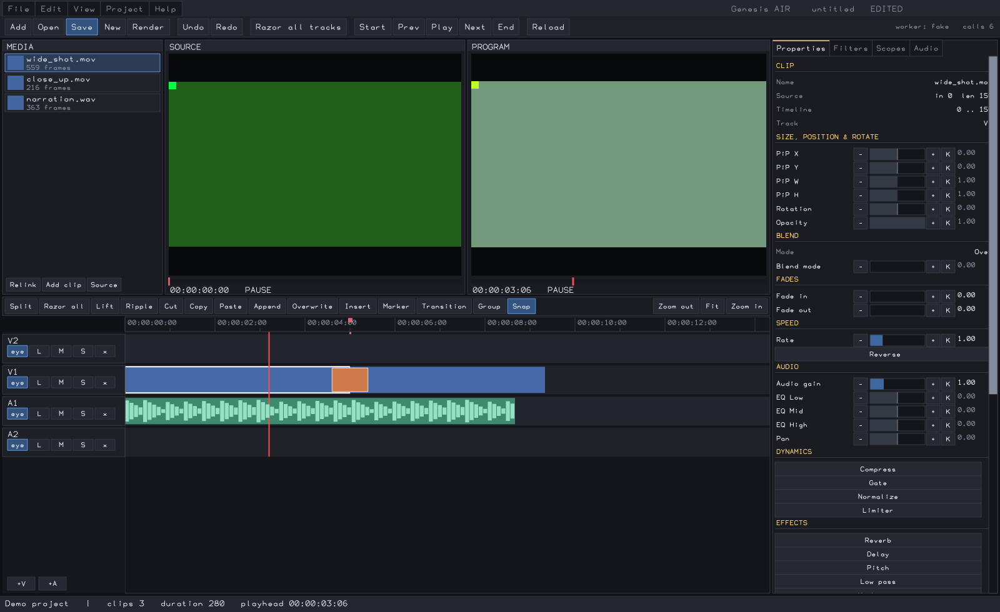

# Genesis AIR

A native non-linear video and audio editor written in AIR. The Windows build uses Win32,
Direct2D and Windows audio output. GTK is forbidden in the Windows build configuration.

Built with **AIR**, a native compiler designed for agent-assisted development: [air-lang.pages.dev](https://air-lang.pages.dev/)



Genesis AIR **uses** AIR; it is not part of it. The application lives here, the language,
compiler and toolkit live in their own repository, and no AIR source is copied into this
project — [`air-sdk.conf`](air-sdk.conf) records which AIR commit it is built against and
[`build.sh`](build.sh) discovers the toolchain from there.

```
Genesis AIR application     this repository
        |
        v
AIR portable toolkit        std.widgets, std.draw, std.gui, std.timeline, std.media_*
        |
        v
AIR editor/NLE toolkit      std.editor, std.editor_io, std.editor_view
        |
        v
AIR stdlib
```

## What it is

Windows Genesis reuses the [shared MM-AIR media runtime](docs/FFMPEG_GPU_PREVIEW.md)
and calls its codec libraries directly from the native compositor. Setup accepts
`-MmAirRoot` (default `C:\MM-Air`); Genesis does not package a separate FFmpeg
executable or codec DLL set. An optional native Vulkan decoder is available with
`GENESIS_VIDEO_BACKEND=vulkan`; D3D11 remains the default. Downscaled P010
BT.2020/PQ previews now use native D3D11 compute color conversion and scaling,
with FP32 intermediate math and 16-bit channel quantization. Set
`GENESIS_GPU_PREVIEW=0` to use the reference CPU transform. Masters retain that
reference transform. The current validated candidate also has a runtime-qualified
native-size P010/PQ preview shader; unsupported configurations use the reference.
The earlier playback checkpoint passed a bounded 133.89-second playback check from the
supplied 4K/59.94 source with live stereo audio and fitted 480x270 monitors. Its
steady interval presents 59.9377 changed pictures/s without skipped positions or
presentations beyond the existing two-frame lateness limit. Fullscreen 4K,
whole-duration and compound 4K60, and physical audio/display synchronization remain
unqualified; [measured results and restrictions](docs/FFMPEG_GPU_PREVIEW.md) distinguish
headless preparation from actual display performance.

The [current native playback validation](docs/WINDOWS_PLAYBACK_VALIDATION_2026-10-10.md)
records each qualified build's editing, modal recovery, export and native cadence
checks alongside the retained failed and incomplete timing experiments.

Video with sound now uses linked video and audio lanes: frame thumbnails on V1,
processed waveforms on A1, with synchronized edits and one sound contribution.
Native Open converts supported older layouts in memory; Save keeps the new layout.
[Linked-lane behavior and validation](docs/LINKED_MEDIA_WINDOWS_2026-10-10.md)
describe conversion safeguards and the background test scope. The linked-lane build
passed the complete background Windows gate and a bounded check of the supplied
1080p clip. Separately scoped [native workflow evidence](docs/NATIVE_WORKFLOW_WINDOWS_2026-10-11.md)
now covers linked audio controls, multiline Unicode titles, modal safety, export
Cancel/retry and a short runtime timing trace on the earlier 056E candidate.
The earlier F718 build passes the complete background Windows gate, its own
exact audio-device proof and a short native linked-lane workflow. The broader title
and export observations retain their earlier 056E scope. That checkpoint did not
qualify sustained cadence or complete its final root-ready/archive acceptance. The F718 first-epoch
native timing traces fail the unchanged strict cadence gate: five omitted positions
at 1080p, and nine omissions plus five presentations more than two frames late
for fitted 4K. The pixel-credit checkpoint below has separate passing timing and
native workflow evidence and is now published in the root workspace.
Physical speaker/display alignment and fullscreen 4K remain unqualified.

The published `pro-native-pixel-credit-2026-10-11` build combines a bounded loopback
socket policy, 16×64 KiB pixel-channel messages and an isolated Genesis opt-in to
immediate Direct2D presentation. The channel still allows 1 MiB payload; native
send allowances are separate from application pixel storage. Focused FIFO,
presenter checks, coherent build and same-binary full background retry pass.
Its exact audio-device gate also passes. First-epoch native cadence passes at
59.9985 changed pictures/s over 137.687 steady seconds for 1080p60, and 59.9393/s
over 166.001 steady seconds for the 4K/59.94 source in a fitted 480×270 monitor.
Both steady intervals have zero omitted/repeated positions, early/backward or
more-than-two-frame late presentations, audio-queue drains and packet overwrites.
The full 50,000-row recorder traces retain startup repeats/drains; the unchanged
parser excludes its fixed first second and final half-second. This qualifies
these bounded recorded intervals, not the whole source or physical scanout.
Its fresh native workflow verifies linked lanes, scrub/scopes synchronization,
gain/pan/mute/unmute, Program and Source playback, silent Stop, nonblank rewind
and private Save/Open persistence. Title/export observations retain their earlier
056E scope. Fresh root-ready passes with both monitors populated at zero and
separate V1 filmstrip/A1 waveform. The [evidence bundle](archive/pro-native-pixel-credit-2026-10-11.tar.gz)
and [archive receipt](archive/pro-native-pixel-credit-2026-10-11.json) retain the
source and validation results; the receipt records the archive SHA. The first background attempt failed
the unchanged playback-timing picture-gap limit; a focused repeat passed, and a
separate full retry retained 64 fresh reports without replacing that failure.
The SDK presentation default remains
refresh-wait; software submission does not prove every-frame physical scanout.

The unpublished `pro-native-edit-export-r4-2026-10-11` candidate passes its
coherent build, full background suite with 72 fresh reports, exact audio-device
gate and native editing workflow. Native title pointer/Unicode editing,
Cancel/Undo/Redo, gain-key navigation/interpolation/deletion and idempotent
Save/Open are verified. A long native export cancels and cleans up; a fresh short
export after reopening passes independent picture/title/audio checks. This does
not establish same-target native retry. Durable audio processing contexts and
compound child padding pass independent PCM and model checks. Both r4 cadence
attempts fail the unchanged 120-second minimum: the 50,000-row trace cap leaves
105.1847 and 108.6679 steady seconds. The captured steady intervals have no
omissions/repeats/backward/early/late-over-two-frame pictures or audio-queue drains;
they remain too short for acceptance. Existing per-loop trace sensitivity and
unchanged playback source hashes do not establish a new scheduler defect.
The recorder-only r5 repair passes its qualification gates and its exact root
products are now installed as B079/75F9/A8E; publication and fresh root-ready
pass. The accompanying source and evidence archive identifies this installed
checkpoint; `690aa8b` is the prior committed checkpoint.
The r5 recorder/test source is now frozen and passes 12 cases and 2,641 checks
on both Windows and Linux; the baseline retains a duplicate-poll failure.
It preserves every presentation, actual device sample, input batch and semantic
change, while retaining identical poll-only state at a 16 ms threshold on the
next available loop. A zero-count sampled-clock marker is internal; the 46-column
trace and 50,000-row cap are unchanged. Only the recorder and its fixture differ
from r4; scheduler, parser, SDK, worker and shared runtime remain identical.
The coherent r5 build passes all 69 targets. Its first full background attempt
refuses an exclusive existing r4 nested-edit-context report before running those
cases; this is a report collision, not a nested PCM failure. The failed log and
47 fresh partial reports remain preserved, and the immutable r4 proof is unchanged.
A fresh full repeat passes with 72 fresh reports, the same script and unchanged
source/thresholds under exclusive alternate receipts. The original failure
remains preserved. The exact r5 device gate passes with −0.320 ms interval drift,
0.430 ms phase range and no drain/resume shortfalls; this is not a physical
speaker/display alignment measurement. Its completed native workflow covers
linked-lane migration, Play/mute/unmute/Stop/nonblank rewind, scrub/scopes and
zoom, idempotent two-clip Save/Open and pointer/Unicode title editing with
Cancel and one Undo/Redo. Active full-range export cancellation cleans up;
reopening the saved short range and exporting to a fresh different destination
succeeds. Same-target native retry and new keyframe GUI checks were not exercised
on r5. Independent inspection of its 178-frame export passes at three picture
positions, with over 99.9% title-interior coverage, 142,400 AAC sample frames
and worker PCM within one code. R5's first 1080p cadence interval passes:
10,085 consecutive pictures over 168.069 seconds at 59.999314 pictures/s,
with no steady omissions, repeats, early/backward or late presentations, queue
drains or overwrites. Its fitted 4K/59.94 interval also passes: 11,953 consecutive
pictures over 199.402 seconds at 59.939363 pictures/s, with the same zero steady
faults and maximum gap 24.9929 ms. Both use the ordinary editor's 480×270 monitor,
fixed parser exclusions and preserved raw traces; they do not establish physical
scanout, fullscreen 4K, compound 4K60 or whole-source playback. Publication binds
the accepted full background repeat and preserves the original failed attempt.
Fresh root-ready verifies the actually loaded B079 application and 75F9 audio
DLL: the private saved 1080p project has two linked clips, V1 filmstrip only and
A1 waveform only, populated Source/Program monitors, active Program playback
and stereo meters, Stop retaining the picture with cleared meters, and nonblank
Start at zero. The root editor is left open paused. The accompanying
[source and evidence archive](archive/pro-native-edit-export-r5-2026-10-11.tar.gz)
and [archive receipt](archive/pro-native-edit-export-r5-2026-10-11.json) bind the
tested source and installed payload; the publication commit is identifiable
through Git history.
The [professional editing acceptance ledger](docs/PRO_EDITING_ACCEPTANCE_WINDOWS.md)
binds the exact r4/r5 receipts, retained failures and remaining Delay/Reverb,
full-history retime and transition-control limitations. The broader goal remains active.

An AIR-native editing application with a tested project and control layer. Its media
renderer covers the paths listed below; [the control acceptance ledger](docs/CONTROL_COVERAGE.md)
tracks every exposed control and its remaining media gate.

```
menu
toolbar        Add  Open  Save  New  Render  Undo  Redo  Razor all tracks
               Start Prev Play Next End  Reload            worker readout
+-----------+-------------------+-------------------+-------------------+
| MEDIA     | SOURCE monitor    | PROGRAM monitor   | Properties        |
|  bins,    |  own transport,   |  own transport,   | Filters           |
|  Relink   |  in/out marks     |  in/out marks     | Scopes            |
|  Add clip |                   |                   | Audio             |
|  Source   |                   |                   |                   |
+-----------+-------------------+-------------------+                   |
| Split Razor Lift Ripple  Cut Copy Paste  Append Overwrite Insert       |
| Marker Transition Group Snap                    Zoom out  Fit  Zoom in |
+-----------+------------------------------------------------+          |
| V2 eye L M S x |                                            |          |
| V1 eye L M S x |  clips, transitions, fades, markers,       |          |
| A1 eye L M S x |  waveforms, ruler, playhead                |          |
| A2 eye L M S x |                                            |          |
| +V  +A         |                                            |          |
+----------------+--------------------------------------------+---------+
status / prompt line
```

The right-hand dock has four tabs:

- **Properties** — everything about the selected clip in one scrolling column: name, source
  and timeline ranges, size/position/rotate (PiP X, Y, W, H, rotation, opacity), blend mode,
  fades, speed, audio gain, a three-band EQ with pan, dynamics (compress, gate, normalize,
  limiter), thirteen audio effects (reverb, delay and delay decay, pitch, low pass, high
  pass, tremolo, bass, treble, notch, chorus, flanger, phaser), a ten-band graphic EQ, and
  clip grade. Every parameter has a decrement, a click-anywhere bar, an increment and a
  keyframe button. Slider drags update live, clamp on release outside the control, and
  form one undo step; Escape restores the previous value. A parameter whose filter does not exist yet is still shown; touching it
  creates the filter. Some keyframe actions are refused while their media automation path
  is unfinished; the [control ledger](docs/CONTROL_COVERAGE.md) tracks those gaps.
- **Filters** — the stack on the selected clip (enable, reorder, remove, and the selected
  filter's own parameters) above a library of **51 filter kinds**, 31 video and 20 audio.
  Text has an editable content field and LUT3D has a `.cube` path field. These strings
  persist in revision 2 projects. Projects with retained audio processing context
  use revision 3; the current reader accepts revisions 1, 2 and 3. Earlier Genesis
  versions refuse revision 3 rather than silently losing that context.
- **Scopes** — histogram, RGB parade and luma waveform, read off the program frame that was
  already fetched for the monitor.
- **Audio** — live stereo output meters in dBFS after the complete mix. Tracks with sound,
  including embedded audio on video tracks, expose gain, pan, mute and solo. Selected clips
  expose their own gain, pan, EQ and audio effects. Native import and normal Open separate
  linked video and audio: V1 shows frame thumbnails and A1 shows the audio waveform.
  Waveforms are drawn only on audio tracks, including when older recovery data retains
  embedded sound on a video track.
  Clip gain supports K keyframes on both audio and video lanes. After the first gain key,
  editing the fader writes a key at the playhead; its reading follows the curve when seeking.
  Fade in/out also support K on audio and video lanes. Their readings follow the curve;
  after the first key, a fader edits the clip-local key at the playhead and preserves its
  interpolation. Gain and Fade drags remain one undo step. Track faders and audio-filter
  parameters remain static.

Video-filter faders also show evaluated keys and edit the envelope after the first
K key. A drag creates or updates one clip-local key in one undo step. Unsupported
fields/layers and stale selections report coded errors. New Blend Mode keys use
Hold interpolation so their integer mode identifiers switch at exact key frames.

Keyed parameters show **Previous key**, **Next key** and **Delete key** controls.
Navigation pauses playback and seeks to that parameter's nearest key inside the
clip. Delete and the separate interpolation row act on the exact key at the
playhead and form one Undo step. The interpolation row shows the full shared
curve name and cycles through its 38 modes; Blend Mode keeps Hold. Removing the
last key restores the parameter's static value without changing another filter
instance's curve.

Mouse gestures on the timeline: click a clip to select it, drag a clip to move it between
lanes or along time, and drag within seven pixels of a clip edge to trim it. Each monitor has Start, Previous frame, Play/Pause, Stop, Next frame and End buttons,
plus a draggable seek bar. Seeking pauses the transport so its clock cannot override the
requested frame. Drag the ruler
above the lanes to scrub the program preview; click it to seek once. A clip move or trim is
one undo step — nothing is written until the pointer is released — and drops snap to
neighbouring cuts when Snap is on.

The right inspector scrolls under the pointer with the mouse wheel. Its scrollbar supports
track clicks for page movement and direct thumb dragging; it does not depend on prior focus.
Scroll over the track headers to reach lower lanes, or use their Up/Down buttons.
The wheel over the timeline body still moves along time; Ctrl-wheel changes zoom.
Lane navigation preserves the project and playhead and clamps after resize or track edits.

All of it is driven by project state, saved to and loaded from the AIR editor project schema.

The rule the whole application is built around:

```
user input  ->  editor command  ->  project state changes  ->  UI redraw
```

`std.editor.Document` is the only place a project fact lives. A widget never holds a second
copy of a clip, a track or a transport position; the view reads the document at paint time.
[`src/commands.ai`](src/commands.ai) is the single path to a mutation. Each undoable action
captures one snapshot, then applies its toolkit operations. **There is no edit arithmetic
in this application** — split, trim, ripple, slip, roll, slide, grouping, undo/redo,
transitions, keyframes, the media pool, subtitles, the mixer and the transport model all come
from AIR's reusable NLE toolkit, which was itself derived from Genesis.

## Source map

| file | what it owns |
|---|---|
| `src/app.ai` | application state. The document is authoritative; everything else here is view state — focus, viewport, dock tab, snapping, clipboard, the in-flight pointer gesture, the prompt. |
| `src/layout.ai` | panel geometry. One function computes where every panel sits, so painting and hit testing cannot disagree about which pixels belong to which panel. |
| `src/chrome.ai` | every clickable control, built once as a list carrying its own rectangle, label and state — plus the filter library and its parameter schemas. The view paints this list; the input layer hit-tests the same list. Neither computes a rectangle. |
| `src/view.ai` | painting. Reads project state and caches TrueType glyphs; media work stays outside paint. |
| `src/input.ai` | which command a click, drag or key means. Never edits the document. |
| `src/commands.ai` | the only path to a mutation: capture once for undo, then apply toolkit operations. Installing another project starts a fresh history and clears project-specific media caches and clipboard. |
| `src/project_session.ai` | Save/Discard/Cancel before New, Open, Recover or Close; replacement waits for a successful save and cancelling Save as cancels the deferred action. |
| `src/recovery.ai` | independent autosave timer, separate recovery snapshots, legacy recovery reader and managed-file cleanup. |
| `src/provider.ai` | the media seam: source probe, frame and waveform retrieval, and the worker transport. |
| `src/timeline_media.ai` | resolves AIR editor clips into the worker's preview, encode, and audio commands. |
| `src/picture_memory.ai` | lowers internal FP32 picture passes to immutable, frame-scoped GPU snapshots and releases them after their last use. |
| `src/audio_playback.ai` | background audio owner; retains native clip graphs, resets transport generations and publishes coded failures. |
| `src/transport_clock.ai` | elapsed-time transport fallback; native Windows playback uses the audio device sample clock. |
| `src/native_audio.ai`, `windows/native_audio.cpp` | typed C ABI adapter for Windows audio queues, sample clock and stereo output levels. |
| `src/preview.ai` | atomic latest-request snapshots, generation-checked RGBA frames, waveforms and timeline bitmaps. |
| `src/preview_link.ai` | bounded `std.channel` command/events and native socket wake for the preview task and window. |
| `src/ui_text.ai` | cached, proportional system TrueType UI text through `std.font`. |
| `src/main.ai` | the verbs and the window loop. |

## Build and run

```sh
cd Genesis-AIR
./build.sh                       # -> build/genesis-air

# Build the separate media worker from CodeAlexx/Genesis- (FFmpeg/OpenCL prerequisites
# are described in that repository), then point Genesis AIR at it:
cd ../Genesis
git switch codex/air-raw-transition # RAW transition partners and Stabilize source frames
cargo build --release -p gcompose
export GENESIS_GCOMPOSE="$PWD/target/release/gcompose"
cd ../Genesis-AIR
```

On Windows, use PowerShell 7, Visual Studio 2022 C++ Build Tools (including CMake),
Git, and WSL Ubuntu with CMake 3.24+, Ninja and a C++20 compiler. Build AIR from the
pinned SDK with the script below. AIR emits C in WSL;
MSVC builds the Windows application. The installed editor runs directly as a Windows GUI
executable, and its redirected media subprocesses do not open console windows.

```powershell
.\setup-windows.ps1
.\build-compiler-wsl.ps1
.\build-windows.ps1 -RunTests
.\Genesis-AIR.exe open .\project.air
```

Both setup and build default to the repository root. The output includes
`Genesis-AIR.exe`, the native host/audio DLLs, `genesis-gcompose.exe`, `air-file-publish.exe`,
`genesis-media-runtime.txt`, `OpenCL.dll`, `fonts/` and dependency `licenses/`.
Keep these together. MM-AIR supplies the shared media libraries and existing
FFmpeg/ffprobe tools; use setup's `-MmAirRoot` for an installation outside `C:\MM-Air`.
The compiler builder defaults to `/root/Genesis-AIR-compiler`, a separate build tree
attached to this SDK checkout. It preserves unrelated compiler trees. Override its
`-BuildDirectory` and pass the resulting `bin/airc` to `build-windows.ps1 -LinuxCompiler`
when needed; both scripts accept `-Distro`. Rebuild the matching compiler when updating
the SDK pin, because this version uses the generic `array.copy` and `array.repeat`
operations for bulk RGBA imports and surface allocation.

Setup creates isolated SDK and compositor checkouts under `build-windows/`, applies the
tracked compositor patch, and builds the native media dependencies. Existing checkouts
at a different revision are preserved and reported. `-AirSdk` or `AIR_HOME` overrides SDK
discovery. `-Destination` stages a build elsewhere; run setup with the same destination
when preparing a complete package. `-Launch` opens the editor after building.
For an isolated build/test run, pass `-NativeBuild`, `-GeneratedDirectory` and
`-Destination` under a private `build-windows/` folder; `-Worker` selects the
candidate compositor used by the media gates. This keeps concurrent AIR generation
and native build outputs separate.

The SDK is pinned in [air-sdk.conf](air-sdk.conf). The compositor, OpenCL and Rust revisions
are in [windows/source-pins.json](windows/source-pins.json); FFmpeg and font downloads have
pinned digests. Windows compositor changes, including FP32 intermediates, 16-bit decoding
and encoding, HDR conversion and arbitrary preview dimensions, live in
[windows/gcompose-windows.patch](windows/gcompose-windows.patch).

```sh
# headless: paint one frame of a project
build/genesis-air render OUT.png [PROJECT.air]

# headless: build a small project, edit it, save it, paint it
build/genesis-air demo OUT.png [PROJECT.air]

# inspect source media, optionally saving a short test project
build/genesis-air probe MEDIA.mp4 OUT.png [PROJECT.air]

# compose the saved project's playhead frame, or encode its export range
build/genesis-air preview OUT.png PROJECT.air
build/genesis-air export OUT.mp4 PROJECT.air
build/genesis-air audio OUT.wav PROJECT.air   # mix audio from the playhead

# windowed (needs a display)
build/genesis-air open PROJECT.air
build/genesis-air new [--appearance dark|light|system]
```

The window enlarges the editor canvas, text, controls, and pointer targets to 1.5× on
large displays (at least 2400×1250) and 2× on 4K sized windows (at least
3200×1600). Smaller windows retain the original 1× layout. This changes only the
editor interface; project dimensions and exported video resolution stay as set in
the project.

The application first finds `genesis-gcompose.exe` beside its executable, then checks
sibling source builds and PATH. `GENESIS_GCOMPOSE` overrides worker discovery. The
shared-runtime location file supplies MM-AIR's FFmpeg/ffprobe paths; legacy sibling
and PATH discovery remain available. `GENESIS_FAKE_PROVIDER=1` selects the
deterministic test provider; real preview and export require the compositor.
`GENESIS_SCRATCH` overrides state storage, which defaults to `%LOCALAPPDATA%/GenesisAIR`
on Windows. This holds shared settings, recovery snapshots and `errors.jsonl`.
Startup resolves relative storage paths against the process's current directory
so absolute native-picker paths refer to the same ownership namespace.
Unavailable working directories and ambiguous drive-relative paths such as
`C:state` report `GA_STATE_ROOT` before command work.
Each invocation atomically reserves a private `media/session-<token>-<attempt>`
directory for source/program frames, preview and audio mailboxes, timeline strips,
export progress/cancellation and provider profiles. A second window cannot cancel
the first window's export or replace its cached pictures.

For scripts, set `GENESIS_SESSION_REPORT` to a unique nonexistent caller-owned file
before launching. It receives that invocation's private media directory as one
newline-terminated row. Read `export.cancel`, `export.progress`, `profile` and
`playback-profile` relative to that directory. Existing or unwritable report files
refuse the invocation with `GA_MEDIA_SESSION_REPORT` before command work;
`GA_MEDIA_SESSION` identifies failure to reserve a directory. There is no shared
latest-session pointer. Private cache directories currently remain after exit for
artifact inspection; automatic cleanup of retired sessions remains unfinished.
Coded `[GA_*]` errors appear in the status line and local structured diagnostics;
Help > Show error details reports the diagnostics path.

New, Open, Recover and closing the window ask **Save / Discard changes / Cancel** when
there are unsaved edits. Save must publish successfully before the requested action runs.
A failed save leaves the project and decision open with a `GA_SAVE_PUBLISH` error;
cancelling Save as cancels the pending action. Tab or the arrow keys choose a button,
Enter activates it, and Escape cancels. Opening a missing or invalid project preserves
the current document. A successful New/Open/Recover starts a fresh undo history and
clears the prior project's clipboard and timeline media caches.

Project saves use an exclusive sibling temporary and atomic replacement. Autosave has
its own 30-second timer, including while playback is paused with no further input.
Media/effect edits keep this interval; replacing the project allows its first snapshot
immediately. Each editing session creates a separate `.air` snapshot in `recovery` below the scratch
directory, retaining the original project path. Startup offers the newest readable
snapshot whose ownership is available; corrupt, incomplete or live foreign-session
records are skipped and kept. **Recover** opens a paused
copy for Save as, and **Keep current** leaves the snapshot available. File > Recover autosave
opens the recovery picker, including this session's current snapshot. When Recover is
pending, the autosave timer preserves the selected snapshot until the decision is
resolved, including a picker path with different separators or ASCII letter case.
The previous plain-project `autosave.air` is still readable.
Successful Save or an accepted Discard clears this session's managed snapshots; an
ordinary project selected through Recover is never deleted. A failed autosave preserves
the previous complete snapshot and reports a `GA_AUTOSAVE_*` error.
Managed snapshots retain an OS file lock on a stable `.owner` sidecar while the
session owns them, including across atomic snapshot updates. Recovery claims the
lock and rereads the selected record before replacing the project. A competing
live owner reports `GA_RECOVERY_BUSY` and preserves the current document/history;
process exit releases ownership so an orphan becomes recoverable. Sidecars remain
in place to preserve lock identity.

The UI uses system Segoe UI through `std.font`, with proportional metrics and cached
antialiased glyphs. Colors come from `std.application_theme` and `std.desktop_styles`;
View selects the shared palettes. Titles and captions use installed TrueType faces and
the bundled Noto Sans JP fallback. `GENESIS_FONT` lists additional title faces, separated
by semicolons on Windows and colons on Unix. Add, Open, Save as, Export and Relink use
native Windows file pickers. On Linux they use `zenity` when available, with a keyboard
path prompt as fallback.

Export uses the sequence dimensions and rate, including fractional rates; a 4K sequence
is composed at 3840x2160 rather than an enlarged preview. File offers these profiles:

| Profile | Container | Picture | Audio |
|---|---|---|---|
| H.264 SDR | MP4 | 8-bit YUV | AAC |
| HEVC SDR | MP4 | 10-bit YUV | AAC |
| ProRes SDR | MOV | 10-bit YUV | 24-bit PCM |
| Lossless SDR master | MKV | FFV1 16-bit RGB | 24-bit PCM |
| HEVC HDR | MP4 | 10-bit PQ / BT.2020 | AAC |
| Lossless HDR master | MKV | FFV1 16-bit PQ / BT.2020 RGB | 24-bit PCM |

PCM masters preserve the exact final sample count, including a partially filled
encoder buffer. Twenty direct encoder checks cover PCM/FLAC lengths and sample
values around buffer boundaries, plus AAC stream durations. The encoder submits
a short final frame when the selected codec supports it.

Transitions prepare each side's picture effects, fade and opacity separately.
An outgoing contrast edit preserves the incoming clip's colors; incoming opacity
keys and fades now render through the transition. Fifty-one native preview/master
comparisons cover all eleven transition kinds, keyed opacity, fades, separate
grades, overlap, a short gap, titles and an upper layer, with audible audio of the
exact master length. Incoming Blend/PiP/Chroma key and transitions above the base
lane remain unsupported.

Spatial transition windows compose at sequence resolution before fitting the
ordinary monitor, preserving wipe softness and source/mask integer sampling.
Crossfade, dissolve and surrounding frames retain small canvases. When feasible,
the fitted canvas uses an even multiple of the exact sequence aspect ratio; a
4K portrait sequence uses 144x256 inside a 480x270 monitor. Large irreducible odd
ratios retain the bounded rounded fallback. Native 4K spatial-transition playback
at 60 fps remains unmeasured; fullscreen 4K work remains deferred.

Media decode retains 16-bit precision and composition/intermediate passes use FP32.
Compound pictures and ordered video-filter passes now keep their internal FP32
results in immutable GPU snapshots instead of round-tripping full pictures through
scratch files. Frame-scoped identities prevent stale references; snapshots and
retained canvases share a 4 GiB budget. Final preview readback and encoded output
retain their existing formats. The encoded format determines the final quantization. HDR sources are tone mapped to
Rec.709 for the ordinary SDR preview; HDR masters retain PQ / BT.2020. This is not a
calibrated HDR display or a scene-linear grading pipeline.

The headless `export` command selects H.264 for `.mp4`, ProRes for `.mov`, and the
16-bit SDR master for `.mkv`. `--hevc` selects HEVC SDR and `--hdr` selects an HDR
MP4 or MKV. The `render` command writes an editor-canvas PNG. Existing export files are
refused. Export runs from a project snapshot in a background task; the status reports
progress and Escape cancels between frames, during worker pipe waits, and while
waiting for the encoder to exit. Cancellation is checked in 50 ms I/O steps;
the export owner stops its worker before removing incomplete output. A final
cancellation check precedes publication. Worker, cancellation, path and publication
failures have `GA_EXPORT_*` codes; ordinary UI cancellation shows `export cancelled`.
Each job claims an exclusive `.genesis-air-owner` directory beside its target,
writes its private partial there, and publishes the completed file atomically
without replacing a destination created during rendering. The portable
`air-file-publish` helper performs that final filesystem operation and has no media
dependencies. Competing jobs report `GA_EXPORT_BUSY`; a late destination is
preserved with `GA_EXPORT_EXISTS`. A missing helper reports `GA_EXPORT_HELPER`
before creating output. Cancellation removes the job's known partial and sidecars
after joining its worker; unexpected files remain untouched. If publication
succeeds but reservation cleanup fails, the export remains successful and reports
`GA_EXPORT_PUBLISHED_CLEANUP`, with `cleanup.error` retained in the reservation.
Cancellation with an additional cleanup error retains that diagnostic in the UI.
`export.progress` and `export.cancel` in the private media directory reported by
`GENESIS_SESSION_REPORT` expose the same scriptable
progress and cancellation path.

Windows playback prepares bounded five-second WAV chunks on one background thread and
queues native audio buffers. One retained compositor session keeps each active clip's
decoder, resampler and effect graph alive across those chunks, preserving delay,
compressor and other filter history. Absolute 48 kHz sample boundaries prevent chunk
rounding from accumulating at fractional frame rates. The device's sample clock drives
the source/program playhead.
Reverse playback decodes two-second source windows from the end of the clip and feeds
the reversed PCM into the retained effect graph. Decoder/resampler preroll protects
window boundaries. Source trims now count native decoded samples before resampling,
anchored to the first decoded frame timestamp after codec skip/edit handling. Positive
source origins insert silence and negative origins skip pre-zero samples; coarse
Matroska packet timestamps no longer select trim edges. This keeps reverse source
buffering independent of clip duration while preserving delay and speed history.
Origin-based fresh selection may decode from the beginning, so distant audio seeks
remain O(seek). Later timestamp discontinuities are not repaired.
Pause, Stop and seek immediately reset output; gain, pan, mute, solo and audio-effect
edits invalidate queued sound. Picture-only edits preserve it. The meters read the PCM
at the device cursor after mixing. Preview decoding runs on a separate thread; rapid
seeks publish the newest requested frame. Waveform completion is published independently
so an early image result cannot hide a later audio envelope.

Clip gain keys are evaluated per 48 kHz stereo sample after the audio effects, then
multiplied by track gain and the clip fades. Playback and export share rounded absolute
key boundaries and all 38 interpolation modes from the pinned `std.curve` contract.
Automation changes do not rebuild the retained effect graph between chunks; a seek or
actual key edit invalidates queued sound. Negative curve overshoot clamps to zero.
Malformed gain envelopes report `GA_AUDIO_GAIN_KEYS` and the next request can recover.

Fade-length keys follow the same destination sample clock. Each curve retains raw
sequence-frame coordinates and values through interpolation, then converts the length
to seconds. Audio multiplies the separate fade-in and fade-out ramps, preserving the
existing scalar fade convention; picture opacity uses the smaller ramp. Source trim,
speed and reverse affect decoding while the fade curves stay in timeline time. Complete
surrounding keys remain part of the curve after a seek, including signed and off-body
context. Negative evaluated lengths clamp to zero. Invalid fade envelopes report
`GA_AUDIO_FADE_KEYS` before changing decoder state. Fade edits invalidate queued audio.

Playback pipe reads and writes check Stop and superseding requests in bounded 50 ms
steps. The owning thread terminates a stale worker and removes its partial WAV;
partial write offsets and reply fragments survive ordinary short waits. An unreadable
or invalid request marker reports `GA_AUDIO_STREAM_CONTROL` and permits recovery on
the next valid request. Ordinary Stop/seek cancellation is silent.

The `audio` command writes the program mix from the current playhead for inspection.

## Keys

| | |
|---|---|
| Space | play / pause |
| `s` | split at the playhead |
| Delete / Shift+Delete | lift / ripple delete |
| Ctrl+Z, Ctrl+Shift+Z, Ctrl+Y | undo, redo |
| Left / Right | frame step |
| Home / End | start / end |
| `i` / `o` | mark in / out |
| `m` | marker at the playhead |
| `g` | group the selection |
| `+` / `-`, Ctrl+wheel | zoom |
| Ctrl+C / Ctrl+X / Ctrl+V | copy / cut / paste |
| Ctrl+A | razor every track at the playhead |
| `t` | transition at the selected clip's cut |
| `n` | snapping on / off |
| Tab | next inspector tab |
| Page Up / Page Down, wheel over the dock | scroll the inspector |

Text values and the file chooser fallback use a centered prompt: type the value,
**Enter** accepts and **Escape** cancels. In a title-content draft, **Shift+Enter**
adds a line; **Ctrl+A** selects the draft text rather than running the editor's
razor shortcut. **Left/Right** move by the font's supported Unicode clusters;
**Shift** extends the selection. **Home/End** move to the line edges and
**Ctrl+Home/End** to the draft edges. **Up/Down** retain the measured horizontal
caret position. Clicking positions the caret, dragging selects text, and typing,
**Delete** or **Backspace** replaces/removes the selection. The visible caret and
selection scroll with long lines and multiline drafts; authored lines keep their
explicit breaks. The draft is modal: timeline, inspector and transport shortcuts
stay behind it until accept or cancel. Accept edits the original title filter as
one undo step; it cannot apply the text to a different selected clip. If the
original project, sequence, clip, filter or content no longer matches, acceptance
is refused and the replacement target is preserved.

**Help > Record playback timing** starts a trace in the running native window,
without changing playback or project history. Each recording reserves a new file
inside that app's private media session; the status line shows its path. **Stop**
and end-of-clip flush pending rows while recording remains armed for another
Play. Turn the Help toggle off to flush and finish the trace; closing the window
also flushes it. Traces retain the existing 46-column format, buffer 128 rows and
stop at 50,000 rows, including poll-only iterations. Creation or write failures
report `GA_WINDOW_PROFILE_CREATE` or `GA_WINDOW_PROFILE_WRITE` and disable the
recorder without stopping playback. Startup `GENESIS_WINDOW_PROFILE` recording
remains available. The new menu path still needs native acceptance on the final
build; adding a recorder does not establish cadence or physical A/V alignment.

To put a video on the timeline, use toolbar **Add** to choose and import the file, select its
row in **MEDIA**, then choose **Add clip** at the bottom of that panel. Import alone does not
place a clip. **Add clip** appends it to V1, selects it, and reports the added filename in the
status line. The ruler above the tracks controls the program playhead; drag it to scrub the
preview or click it to seek once. Use **Save** to write the project; the first save opens a
file chooser.

## The media provider seam

Genesis AIR never learns where a frame came from.

```
Genesis AIR
    |
    +-- editor model (std.editor)
    |
    +-- MediaProvider            src/provider.ai
            |
            +-- gcompose         the existing Genesis worker, in its own process
            +-- fake             deterministic, no FFmpeg/OpenCL/GPU
```

The provider handles probe, thumbnail, source frame, waveform and program frame requests.
`timeline_media.ai` resolves visible clips from `std.editor.Document` and builds the donor's
103-field `PREVIEW`/`ENC` wire. Preview and export use the same resolver. Export holds one
piped worker through `OPEN`, the frame and audio commands, and `CLOSE`.

**Process isolation is preserved.** Genesis measured NVIDIA OpenCL initialization crashing
intermittently against a UI GL/GLX stack, so the compositor stays out of this process. The
provider keeps one `gcompose --serve` process open for probes, thumbnails, waveforms and
previews, so OpenCL starts once and decoders stay open between requests. A worker that exits
or crashes is replaced once and the request retried. Reload and Relink restart it so changed
files are read again. Export runs its own worker.

`gcompose` is selected automatically when its worker is present; otherwise the fake provider
is used for editing and headless checks. Preview and export explicitly require the real worker.

## Playback and seeking on Windows

Each monitor has Start, Previous frame, Play/Pause, Stop, Next frame and End, plus
**Full** for fullscreen playback. F11 opens the focused monitor; Esc or **Exit full**
restores the editor. Transport buttons and the draggable seek bar remain available
in fullscreen. Fullscreen uses a 1280x720 monitor surface; the editor uses 480x270
surfaces. Export resolution comes from the sequence. Space plays or pauses.
Ctrl+O opens a project and Ctrl+S saves it;
Ctrl+Shift+S opens Save as.

Drag the timeline ruler or the playhead line to change program time and preview.
The line takes precedence over a clip underneath it, so seeking cannot move or
trim that clip. Video/audio lane crossing is refused with `GA_TRACK_KIND`. Cached
frame bitmaps fill visible video clips through a separate background decoder, including during playback;
sampling follows the painted thumbnail width instead of leaving large empty gaps;
waveforms also appear on video clips that contain audio.

Both monitors reuse unchanged pictures. Source transport changes keep the program
picture, while timeline edits refresh it. Reload, Relink and opening a project
invalidate the background media cache, including LUTs replaced at the same path.
Timeline thumbnails and waveforms use their own request lane and provider. Transport
and selection changes reuse the same strip request, so playback does not repeatedly
cancel extraction. Clip edits, viewport changes and media reloads request fresh strips.
Each bitmap records its native source frame and timeline position; readers and painting
refuse an obsolete mapping after a trim, move, reverse or rate change. Waveforms carry
their source endpoints and length. Incomplete strip slots retain the last owned pictures.

Monitor timecodes use the decoded picture's frame stamp. During playback the timeline
cursor follows that same program frame; paused scrubbing changes the requested position
immediately. RGB histogram channels have independent bars, including equal-height bins
in black and white frames, and refresh from the displayed program picture. RGB parade
and luma waveform retain each sample's horizontal picture position and plot its signal
level vertically; they use the same displayed SDR program frame. Luma uses Rec.709
coefficients. These scopes describe the tone-mapped preview rather than the HDR master.

The window caches its audio mix and project snapshot by an explicit document-mutation
revision. Transport ticks reuse them; edits, slider cancellation, Undo/Redo and project
replacement invalidate them. A picture-only edit compares the resulting audio mix
before restarting sound. Timeline strips also refresh on content, viewport or media
changes instead of every moving playhead tick.

Set `GENESIS_WINDOW_PROFILE` to an absolute local TSV filename before starting the
editor to measure its actual native presentation and audio sample clock. Diagnostics
are off by default and stop after 50,000 rows. Analyze a recording with
`python tests/window_timing.py PROFILE.tsv --require-active --report REPORT.json`.
It reports unique displayed-picture delivery, skipped positions, presenter/paint/wait
costs and device interval drift. Physical speaker latency and display photon timing
are outside this measurement.

Preview requests and completed frames wake the worker and native window wait through
bounded `std.channel` lanes. Rapid drag requests are coalesced before decoding; frame,
waveform and thumbnail completion have separate events. Document, viewport, monitor
quality and media revision publish as one atomic request snapshot. Monitor pixel
packets carry decoded source/program frame stamps and media revision along with their
dimensions and generation. Diagnostic file slots and timeline strip slots invalidate
their generation before reuse. The reader retains its last complete picture if a slot
changes. This prevents a
rapid scrub from displaying mixed generations or replacing a held frame with an
incomplete publication. `GA_PREVIEW_REQUEST`, `GA_PREVIEW_GEOMETRY`,
`GA_PREVIEW_PUBLISH`, `GA_PREVIEW_PIXELS`, `GA_TIMELINE_REQUEST` and `GA_PREVIEW_CHANNEL` identify request, size, pixel publication
and delivery failures. Request errors carry their generation so a later valid
request can recover. An idle lifecycle deadline also observes persisted Stop if
its wake was lost; normal frame work wakes immediately.

The worker keeps decoder image buffers between frames, composes in FP32, and packs
the final preview on the GPU before downloading it. FLOAT intermediates and master
exports retain their precision. Windows uses D3D11 decoding when supported and prefers
a discrete OpenCL GPU on hybrid PCs. Software decoding remains available with
`GENESIS_SOFTWARE_DECODE=1`; `GENESIS_OPENCL_DEVICE` selects a GPU by name substring.
The Windows decoder reads NV12/P010 staging memory into reusable aligned buffers.
It selects the requested timestamp before copying pixels, so skipped frames during
seeks or rate conversion stay on the GPU. Other layouts and a failed staging read
use FFmpeg's ordinary transfer; `GA_VIDEO_TRANSFER` identifies that recovery.
`GENESIS_DEFAULT_TRANSFER=1` selects the ordinary transfer for diagnostics.
`GENESIS_MEDIA_PROFILE=1` emits staging wait/copy, transfer, colour, RGB conversion
and preview phase timings.

The native provider uses `PREVIEWFIT` to fit and pack the completed program picture
on the GPU before downloading it. The composition keeps its existing resolution, so
spatial effects and export precision retain their meaning. Ordinary 480x270 monitors
receive 518,400 RGBA bytes instead of a 3,686,400-byte 1280x720 canvas followed by a
CPU resize. A monitor-size change renders from the composition again; it cannot
enlarge a cached smaller preview. Legacy `PREVIEW`, intermediate `FLOAT` and export
`ENC` retain their original dimensions and formats.

The working preview canvas fits within 1280x720 and never enlarges a smaller
sequence. A 320x180 sequence is composited at 320x180; fitting to the monitor
happens afterwards. This removes unnecessary filtering and scaling and keeps
small-sequence spatial effects and title rasterization at their export scale.
The native gate checks six canvas formats without changing sequence dimensions
or time. Six complete pixel comparisons cover small landscape, odd-sized and
portrait previews, both plain and with Blur/Text, against independently decoded
16-bit lossless masters. Maximum channel error is one 8-bit unit; the preceding
build fails the same fixture with a maximum difference of 43.

The provider keeps the program picture's read handle on its owning preview thread.
After `DONE`, it rewinds and reads the worker's file, which the worker rewrites in
place. Reload, worker restart, failures and shutdown retire that reader. Reads are
bounded to the expected RGBA byte count plus one; missing or extra bytes produce
`GA_PROGRAM_SIZE`, and open/seek/read failures produce `GA_PROGRAM_READ`. This
removes the repeated Windows file-open cost while retaining exact frame/size checks.

Three paired headless editor runs on the supplied 4K/59.94 AV1/PQ clip use 120
samples after three warmups at 2560x1440. The median of the per-run medians changes
from 23.75 to 21.98 ms for program preparation and from 28.83 to 27.10 ms for the
serial preview path, about 6% overall. These samples exclude native presentation,
audio and asynchronous overlap; sustained smooth 4K60 remains unverified.

The subsequent Windows readback change has three paired 120-sample headless editor
runs on the same clip and window size. Against `7f0d124`, median-of-run-medians fall
from 22.18 to 19.63 ms for program preparation and 27.22 to 24.74 ms for the serial
preview path, about 9% overall. These measurements also exclude native presentation,
audio and overlap; they do not establish sustained interactive 4K60.

A 120-sample measurement of consecutive frames on the supplied 4K/59.94 AV1/PQ clip
and RTX 5080 reached 59.49 worker previews per second at a 1280x720 working canvas,
with identical frame-zero pixels after rewind. This excludes Windows canvas painting,
mailbox conversion and audio; sustained 60 fps in the editor and long-run
synchronization are still acceptance work. The diagnostic defaults to 120 consecutive
frames; `--frame-step 2 --samples 30` reproduces the older sampling pattern.

```powershell
python tests/preview_performance.py --worker .\genesis-gcompose.exe --source 'C:\path\to\clip.mp4'
```

The shared AIR rasterizer now computes axis-aligned rectangle coverage and image
sampling directly, preserving the existing pixels at fractional DPI and under reflection.
Genesis borrows its RGBA window surface through `std.gui.present_surface`; the native
host performs format conversion once, avoiding an AIR RGB24 allocation and a repeated
Windows swizzle. The monitor resampler also uses integer source indices. Shared `array.copy_from`
and `array.copy_within` copy bounded plain-element spans without growing the array.
The resampler reserves its exact RGBA byte length, copies RGB spans and reuses
repeated rows while preserving its existing alpha and letterbox behavior. The
rasterizer reuses an opaque sampled interior row, trimming fractional edge columns
outside the image; transparent rows blend independently against their backgrounds.
Opaque rectangle interiors also reuse their first fully covered row. Fractional
rectangle edges and transparent fills keep independent destination blending.

Playback retains the window canvas and repaints the monitor pictures/timecodes,
old/new playhead strips, status, and live scopes/audio or animated inspector values.
Input and project/layout changes request a complete paint; project dialogs, open menus/prompts,
changed picture dimensions also use a complete paint. Each retained monitor paint
restores its panel bands and picture background before compositing, including transparent
frames, so neither image needs a separate alpha scan. The opaque picture interior
overwrites its destination once. Closing an overlay also repaints its former pixels.
Physical pixel damage boundaries preserve fractional-DPI edges. The window transfers
monitor RGBA pixels through bounded `std.channel` chunks, preserving alpha. Each complete
frame validates dimensions, byte lengths and generation before becoming visible. A held
source monitor is neither decoded nor transferred again; its last received pixels survive
coalesced program frames. Credit waits retry in 50 ms steps and watch Stop/seek markers,
so a slow consumer can resume without accepting an incomplete frame. File image slots
remain available for headless diagnostics through `--file-pixels`.

Three paired editor runs on the supplied 4K/59.94 AV1/PQ clip compare the stream
with file delivery in the same build. Each run uses 120 samples after three warmups
at 2560x1440, with 480x270 monitor surfaces; pair order alternates. The table gives
the median of the three per-run medians:

| Median phase (ms) | Pixel stream | File diagnostic |
|---|---:|---:|
| Request to ready notification | 25.99 | 28.90 |
| Import completed images | 0.07 | 4.10 |
| Worker frame publication | 0.26 | 3.10 |
| Retained canvas paint | 2.47 | 2.50 |
| Complete serial diagnostic | 28.58 | 35.28 |

The serial diagnostic takes about 19% less time. Program-monitor preparation
remains 23.52/23.53 ms, so decoder/compositor work is still the largest measured
cost. These runs exclude native presentation, audio and pipeline overlap;
sustained smooth 4K60 is not established. Current work targets ordinary editor
playback; fullscreen 4K work is deferred.

At the retained-painter checkpoint (`77ea56a`), retained painting took 7.39 ms
median versus 42.23 ms for a complete paint. AIR now provides true nonblocking
socket accept/receive operations, which `std.channel.recv_now` uses instead of a
timed empty read. The profile found that the former half-millisecond deadline
actually delayed an empty wake-coalescing pass by 11.55 ms on Windows. The final
build drains that queue in 0.03 ms median, without changing blocking
channel delivery or discarding partial greetings/frames.

The opaque-background checkpoint was measured with 20 samples after three
warmups on the supplied 4K/59.94 AV1/PQ clip and RTX 5080 in a 2560x1440 canvas:

| Median phase (ms) | Editor | Fullscreen |
|---|---:|---:|
| Request to ready notification | 27.83 | 29.97 |
| Load generation-checked images | 2.41 | 3.30 |
| Retained canvas paint | 2.52 | 6.69 |
| Complete serial diagnostic | 33.28 | 39.59 |

The baseline before panel-band clearing and opaque rectangle row reuse
measured 6.01/21.69 ms painting and 40.01/58.37 ms serial. Painting fell 58% in the
editor and 69% fullscreen. The preceding retained-alpha checkpoint measured
6.00/21.82 ms painting and 36.34/55.32 ms serial; request timing varied between runs.

The opaque-row/span-copy checkpoint (`d5a7d25`) measured 6.12/22.54 ms painting
and 35.80/56.11 ms serial in editor/fullscreen. Before opaque-row reuse,
`8203d66` measured 7.10/27.48 ms painting
and 37.21/60.54 ms serial. The earlier channel-wake checkpoint
(`25178c9`) measured 37.87/35.72 ms request-to-ready and 46.95/66.54 ms serial.
These short headless samples exclude native presentation, audio and pipeline
overlap; they are not an interactive frame-rate claim. Fullscreen CPU painting
and program-monitor preparation remain significant costs. Sustained smooth
4K60 remains unfinished.

```powershell
.\Genesis-AIR.exe profile-preview .\preview-profile.json .\project.air 2560 1440 120
.\Genesis-AIR.exe profile-preview .\file-profile.json .\project.air 2560 1440 120 --file-pixels
.\Genesis-AIR.exe profile-preview .\fullscreen-profile.json .\project.air 2560 1440 20 --fullscreen
.\Genesis-AIR.exe profile-preview .\full-paint-profile.json .\project.air 2560 1440 20 --full-paint
```

This command opens no window. Its `std.bench` JSON separates request-to-ready, completed
image loading, retained painting, borrowed presenter handoff and the serial pipeline.
It also records wake coalescing, snapshot read/decode, source monitor, frame planning,
program monitor, image publication and remaining request time. Those worker phases
carry their frame generation, and their warmup/sample counts match the outer pipeline.
The default profile follows the window's pixel stream; `--file-pixels` reproduces the
file-slot diagnostic for comparison. Phase clocks are measured in the explicit profile.
`--full-paint` measures a complete paint for comparison; it combines with `--fullscreen`. It validates
published image dimensions and a painted panel pixel so an empty frame cannot pass.
`GA_PROFILE_ARGS` identifies invalid dimensions/sample counts; `GA_PROFILE_PREVIEW`
identifies a missing frame; `GA_UI_PRESENT` reports a native presentation failure in the editor.

## Tests

Windows acceptance checks:

```powershell
.\build-windows.ps1 -RunTests -NativeBuild .\build-windows\native-pro
$env:GENESIS_WORKER_WRAPPER = (Resolve-Path .\build-windows\native-pro\bin\Release\genesis-worker-wrapper.exe).Path
python tests/real_media.py --binary .\Genesis-AIR.exe --worker .\genesis-gcompose.exe --stdlib .\build-windows\AIR-SDK\stdlib
python tests/pro_media.py --binary .\Genesis-AIR.exe --worker .\genesis-gcompose.exe
python tests/precision_media.py --binary .\Genesis-AIR.exe --worker .\genesis-gcompose.exe
```

The Windows gate verifies 153 saved application facts, three native file-drop facts,
749 control clicks with overlap checks, 105 native media/project checks and 174 focused
inspector checks, with separate transport/audio gates. Native device tests verify queueing, advancing sample
clock, stereo, panned and silent output levels and immediate Stop. Continuous audio checks compare four
worker cases and thirty-three editor/source/rate/mixer cases against whole-range WAV output;
the generated PCM fixture matches exactly across chunk boundaries. Cases cover all twenty
effects, reverse, 2x speed, fractional rates, seek reset and source audition, plus coded
filter failure, recovery and idle Stop. Six additional native cases interrupt a worker
blocked on a reply or a large stdin write: Stop, seek, and missing request-marker
failure. They verify child exit, partial cleanup, coded failure/recovery and exact
recovered PCM. Active Stop joined in 166–169 ms and seek recovery took 315–317 ms
in the latest headless run; these are stalled-process checks, not interactive A/V
sync measurements. Run that gate separately with:

```powershell
python tests/audio_stream.py --worker .\genesis-gcompose.exe --client .\build-windows\native-pro\bin\Release\genesis-audio-playback.exe --cancel-client .\build-windows\native-pro\bin\Release\genesis-audio-cancel.exe --wrapper .\build-windows\native-pro\bin\Release\genesis-worker-wrapper.exe
```

The editor now prepares pictures ahead of the audio device playhead. A bounded
queue holds at most two complete frames and releases a picture only when its time
is due. Requests continue through the existing coalesced mailbox, so preparing
pictures does not force the decoder to wait for each UI completion. The displayed
picture stamp drives the monitor timecode, playing timeline cursor and histogram.
Paused scrubbing requests the exact frame immediately. Rewind, edits, media reload,
monitor geometry and transport restarts retire old prepared pictures; the parked
Source image can be restored from the channel cache after retirement.

Three alternating twenty-second pairs on the supplied 4K/59.94 AV1/PQ clip
measure a median of per-run picture-delay medians of 78.79 ms for the diagnostic
baseline and 26.46 ms with preparation. Picture delivery varies: 28.35–28.65 versus
25.60–28.70 pictures/second in those short runs. One ninety-second pair over the
same starting interval measures 115.45/52.63 ms median delay, 205.12/138.95 ms p95,
and 17.83/20.90 pictures/second. The prepared run observes 5,354 complete clock/
picture/cursor samples with no audio underruns or early pictures. These are silent
real-device and headless-painter measurements, including mixed audio buffers, with
native presentation and speaker latency excluded. They establish less picture delay
on these runs; throughput still varies with the footage and is below 4K60.

`profile-playback REPORT.tsv PROJECT.air SECONDS [--legacy]` measures the real native
audio device, asynchronous decode/mix and retained ordinary editor paint. It opens
no window and silences final track gain in its loaded copy; it never saves that copy.
Measurements include paint time but exclude native display and physical speaker
latency. `--legacy` is a diagnostic baseline that requests the current heard frame.
The default diagnostic wakes on preview-channel activity and paints only after a
clock, picture or meter change, matching the editor's scheduling policy. `--poll`
reproduces the earlier sleep/poll diagnostic and its paint on every iteration.
TSV reports include individual worker phases, paint/wait durations and the active
timer request, so wait overhead can be distinguished from decoder work.
Profiling also writes `provider-profile.tsv` under the preview task's scratch folder
(`profile` or `playback-profile` below the private directory returned through
`GENESIS_SESSION_REPORT`). Its columns are
`call`, `exchange_ns`, `input_ns`, `read_ns` and `copy_ns`: request/reply, reader
open/rewind, bounded byte read and surface copy. A new diagnostic session resets
the file; ordinary editing writes no rows. `tests/playback_timing.py` includes these
phase medians/p95 values as `provider_ms` when the executable supplies them.
The Windows gate checks a lossless per-frame 23.976-to-29.97 fps fixture through an
eight-second device run, including the five-second audio-buffer boundary. Every
sampled program pixel, picture stamp and playing cursor must agree; future pictures
and audio underruns fail the check. Inspector pixel tests also hold a prepared red
frame out of a blue histogram, release both picture and histogram together, then
rewind to green frame zero while rejecting a late old black picture.

```powershell
python tests/playback_timing.py --binary .\Genesis-AIR.exe --worker .\genesis-gcompose.exe --report .\build-windows\playback-timing-fixture.json --compare
python tests/playback_timing.py --binary .\Genesis-AIR.exe --worker .\genesis-gcompose.exe --project 'C:\path\to\project.air' --seconds 90 --report .\build-windows\playback-timing-long.json
```

The Windows audio clock also accepts driver positions returned in bytes or
milliseconds. It unwraps the native counter before converting to 48 kHz stereo
frames, holds small backward observations, and preserves time when the reported
unit changes. This follows the [Windows position API contract](https://learn.microsoft.com/en-us/windows/win32/api/mmeapi/nf-mmeapi-waveoutgetposition).
Seventy-five controlled native ABI checks cover all three units, repeated rollover,
unit changes, meter indexing, coded failure/recovery, restart and timer lifecycle.
Successful device opening requests a one-millisecond Windows timer period. Stop,
restart and guard destruction release each successful request; device-open failure
makes no request and timer refusal preserves audio playback. The diagnostic
`timer-resolution` operation reports `1` when the request is active and `0` otherwise.
This follows the [Windows timer-period contract](https://learn.microsoft.com/en-us/windows/win32/api/timeapi/nf-timeapi-timebeginperiod).
It improves short wait precision rather than the device clock itself; Windows may
relax timer precision when a window is minimized or occluded.

The Windows gate adds a twenty-second silent real-device run with uneven PCM
buffers, monotonic sample positions, drain, resume and restart. A separate
three-minute run completed 222 buffers with -2.98 ms interval drift and a 3.11 ms
phase range against the monotonic clock. The drained and resumed counts were
exact on this device; millisecond-only drivers have a one-millisecond allowance.
This measures the audio device, without picture presentation or physical speaker
latency. Long-running interactive A/V sync remains unverified.

```powershell
.\build-windows\native-pro\bin\Release\genesis-audio-clock.exe
python tests/audio_clock.py --library .\genesis-native-audio.dll --seconds 180 --report .\build-windows\native-audio-clock-long.json
```

`tests/audio_keys.py` adds 45 keyed-gain cases: all 38 SDK interpolation modes,
reverse, 2x speed, fractional rates, nonzero placement, fades, mute and seeking.
Chunk output agrees with whole-range output within two signed-16 PCM units;
9,276 samples also agree with the independent SDK curve oracle. Linear gain is
checked at every sample and hold transitions at their exact boundary. All cases
round-trip project serialization, including embedded audio on a video lane.
Seven malformed envelopes verify coded refusal and clean recovery. The real-media
gate also decodes an exported MP4's AAC to measure the keyed 4:1 gain step.

Fade controls have a separate ten-case / 128-check controller gate for evaluated
readings, audio K buttons, interpolation-preserving writes, one Undo per drag,
Escape cancellation, save/open and exact refusal state including Redo. A fade-only
write changes the audio signature; Undo restores it and a picture-only key leaves
it intact. The 49-case fade PCM gate compares every intended sample in whole WAVs,
uneven retained chunks and fresh seeks against 2,829,783 SDK sample values, with
2,350 integer editor checks and 32 coded refusal/recovery requests. It covers all
38 curve modes, raw signed/off-body context, trim/reverse/2x, fractional placement,
scalar fallback and the independent product of gain and both fade ramps. Whole-WAV
allocation uses the ceiling of duration in samples; the gate allows at most one
extra stereo sample frame and requires it to be silent. Retained chunks use rounded
absolute endpoints.

Seven independently authored saved-project cases verify every audition and lossless
master sample; three AAC amplitude windows verify a held fade-length change. Source
and saved-project bytes stay unchanged. The seek comparisons isolate fade-envelope
timing from fresh unkeyed decoder output; they do not independently establish source
phase for every codec. These are sample-processing and controller checks, with no
new sustained presentation, sound-device timing or physical hearing claim. See the
[fade acceptance ledger](docs/CONTROL_COVERAGE.md#clip-fade-controls-and-audio-on-2026-10-10).

```powershell
.\build-windows\native-pro\bin\Release\genesis-fade-controls.exe .\build-windows\fade-controls-fixture
python tests/audio_fade_keys.py --worker .\genesis-gcompose.exe --client .\build-windows\native-pro\bin\Release\genesis-audio-fade-keys.exe --report .\build-windows\audio-fade-keys.json
python tests/audio_fade_project.py --binary .\Genesis-AIR.exe --worker .\genesis-gcompose.exe --report .\build-windows\audio-fade-project.json
```

Nested sequence audio now mixes recursively. Each child sequence is summed with
float headroom before its enclosing clip's pan and audio effects, then parent
gain and fades are applied. Each placed instance retains its own decoder/filter
history in private IEEE-float RF64 caches; uneven playback chunks and fresh seeks
slice that processed history. Program audio, audition WAV and export share the
recursive plan. Empty child sequences produce silence, while missing sequences,
cycles, invalid source ranges and resource limits fail with codes before export
publishes output. Nested pictures now have a separate recursive render plan; see
the [compound picture checkpoint](docs/CONTROL_COVERAGE.md#recursive-compound-pictures-on-2026-10-10).

The nested gate checks 18 independently authored projects at every intended WAV,
lossless-master and native whole/chunk/seek sample. It covers child sums, parent
and child gain/mute/solo, a nonlinear parent compressor applied to the sum,
`1.6 × 0.5 = 0.8` intermediate headroom, repeated instances, owner/child frame-rate
mapping, trims, reverse, speed, automation and empty-child recovery. Seven malformed
or unavailable-source projects refuse audition and export without output, partials
or retained owned caches. Four AAC amplitude windows check child automation.
Two genuine 30-minute warm-cancellation cases verify Stop followed by Play in the
same background owner, task shutdown, exited worker identities, cleanup and an
independently checked fresh short request. Source and project bytes stay unchanged.

Limits are depth 16, 4,096 instances, six-hour source/output spans and 32 GiB of
prospective float caches per worker, including old and replacement transactions. Full-history
warming costs time and disk space before the first chunk. A headless native run on
the supplied 300-second source measured about 0.635 seconds to the first chunk and
0.48 ms median warm 50 ms pulls. OS file caching was warm, OpenCL initialization was
included, and the combined Windows gate ran concurrently. These measurements
exclude native presentation, audio devices and physical hearing. The combined Windows
suite and broader preview/export workflow passed. A native window check confirmed
nested stereo meters, Stop/restart, parent controls and Undo, frame-zero rewind,
scrubbed picture/time, filmstrip scenes and updated scopes. See the
[nested audio ledger](docs/CONTROL_COVERAGE.md#recursive-nested-audio-on-2026-10-10).

```powershell
python tests/audio_nested.py --binary .\Genesis-AIR.exe --worker .\genesis-gcompose.exe --client .\build-windows\native-pro\bin\Release\genesis-audio-nested.exe --report .\build-windows\audio-nested.json
python tests/audio_nested_cancel.py --worker .\genesis-gcompose.exe --client .\build-windows\native-pro\bin\Release\genesis-audio-nested-cancel.exe --report .\build-windows\audio-nested-cancel.json
```

The Windows gate also checks a lossless fixture with a different RGB color on every
frame, independently decoded by FFmpeg. Forty-four source/program picture pairs and
their time stamps, plus 128 actual timeline bitmaps, match the expected native frames.
Cases use 23.976 fps media in a 29.97 fps sequence, a clip placed away from frame zero,
trim, reverse, 1.25x/0.5x speed and rewind. This catches an early/late frame within a
scene as well as a wrong scene. Run the check separately with:

```powershell
python tests/frame_identity.py --worker .\genesis-gcompose.exe --client .\build-windows\native-pro\bin\Release\genesis-preview-stream.exe
```

GPU display fitting has forty exact RGBA comparisons against independently fitted
full-canvas frames, including all alpha levels, portrait/odd sizes, blur and final
looks. It also checks size refusal/recovery and unchanged full-precision output:

```powershell
python tests/preview_fit.py --worker .\genesis-gcompose.exe
```

Native video readback adds exact RGBA/float comparisons with FFmpeg's ordinary
transfer for H.264 NV12 and HEVC/AV1 P010. Generated fractional-rate clips exercise
padded textures, reordered frames, skips, final-frame decoding and rewind. Generated
PQ and HLG P010 clips also require HDR conversion on hardware and software decode.
The native color graph adapts to the available logical CPUs with at most eight
threads, preserving its color transform and precision. `GENESIS_MEDIA_PROFILE`
reports the graph limit and CPU count. The gate also checks software fallback
and that only selected pictures are read back. It
reports hardware availability separately. A prior worker and supplied source can
also be compared; the supplied 4K clip passes 504 pixel pairs across these cases:

```powershell
python tests/video_transfer.py --worker .\genesis-gcompose.exe
python tests/video_transfer.py --worker .\genesis-gcompose.exe --reference-worker C:\path\to\previous\genesis-gcompose.exe --source 'C:\path\to\clip.mp4' --last-frame 18807
.\tests\windows.ps1 -Bin .\build-windows\native-pro\bin\Release -Worker C:\path\to\candidate\genesis-gcompose.exe
```

Three alternating twenty-second native-device playback pairs on the supplied
4K/59.94 AV1/PQ clip change only the worker's color-graph thread limit. Delivery
increases from 33.40–35.00 to 36.20–37.75 pictures/second; the median of picture-delay
medians falls from 22.16 to 15.77 ms. A ninety-second pair delivers 25.01/26.24
pictures/second before/after, with 30.63/29.78 ms median delay and 110.32/95.35 ms
p95 delay. Neither run reports early pictures or audio underruns. These silent
real-device measurements include asynchronous decode/mix and retained ordinary
editor paint, and exclude native presentation and physical speaker latency.
This improves the measured preview but still falls short of sustained 4K60.

A subsequent provider measurement found about 4.44 ms in each Windows program-file
open, compared with about 0.12 ms for reading and 0.07 ms for surface copying. The
retained reader reduces preparation to about 0.002 ms. Three alternating twenty-second
pairs using the same compositor and audio DLL improve delivery from 47.00–47.35 to
52.05–55.40 pictures/second; median-of-run program preparation falls from 17.99 to
12.50 ms. A ninety-second pair improves 45.33 to 53.92 pictures/second, with
13.32/12.07 ms median picture delay and 31.83/28.18 ms p95 delay before/after.
The updated run checks 11,530 clock/picture/cursor observations, with no early
pictures or audio underruns. These silent native-device, async decode/mix and
retained ordinary-editor paint measurements exclude native display and speaker
latency. They remain below sustained interactive 4K60. Twenty-six process/file
checks cover changing pixels, resize, bounded malformed-frame refusal, Reload,
worker replacement/restart, broken-pipe retry and diagnostic session behavior.

The Windows gate also compares sixty-second and ten-minute reversed PCM sources,
unequal output pulls, continuous reverse/delay/2x output, fractional 44.1 kHz trims and
a complete twelve-second AAC reversal against independent samples or a whole pass.
Its native process memory check rejects growth proportional to clip duration. In one
paired run, the ten-minute fixture used 160.10 MiB peak worker memory versus 388.60 MiB
before; first-buffer preparation, including process startup, took 172.00/246.48 ms.
These are headless source/filter measurements. Reproduce it or also check supplied media with:

```powershell
python tests/audio_reverse.py --worker .\genesis-gcompose.exe --report .\build-windows\reverse-audio-profile.json
python tests/audio_reverse.py --worker .\genesis-gcompose.exe --media "C:\path\to\video.mp4"
```

The asynchronous preview test measures
red/blue pixels after a 32-request playhead drag, time changes during the drag,
unchanged source caching, rewind to frame zero, painted timeline bitmaps and embedded
audio waveform delivery. It also verifies coded malformed-request/publication
failures, recovery on the same worker, refusal of a reused frame slot, fullscreen
720p frames, in-place LUT reload and idle cancellation without a Stop wake.
The pixel-stream gate adds nine native transport cases: exact RGBA bytes in two
1280x720 surfaces, a consumer paused for 250 ms, held/empty/coalesced source
updates, idle event-wait expiry followed by recovery, Stop/seek during backpressure
and coded malformed-frame recovery.
Generated-media requests check independent source/program seeking and decoded frame
stamps, monitor size changes, rewind, Reload, a 32-request drag burst, strip extraction
during playback, matching bitmap pixels after reverse/trim/2x rate, stale/incomplete
strip refusal, absent monitor frame files and
idle Stop. Project safety has 16 cases /
94 checks for Save/Discard/Cancel, native close-request dispatch, failed-save retry,
separate snapshots, paused final-edit autosave, atomic failure preservation, legacy
recovery and selecting the active snapshot without replacing it while the decision is
open. It verifies original files stay intact, including a normal project inside the
recovery directory. An interactive Win32 check additionally verifies Cancel before
New, native Save as with a Japanese filename, clean New and native Open restoring
the saved gain and pictures; its receipt is
`archive/native-project-lifecycle-2026-10-10.json`. A later root-build check also
verifies native recovery, recovered gain, active stereo meters, nonblank rewind,
ruler scrubbing, changing scopes and a separate Unicode Save as; its receipt is
`archive/native-session-ui-2026-10-10.json`. Native failed-save dialog interaction
still requires a separate check. An additional 24-case / 444-check pixel gate
compares retained playback against the complete painter byte for byte:
all four docks at 1x/1.5x/2x, changing images, forward seeks and rewind, fullscreen,
resize, transport changes, alpha, themes, menus, prompts, keyed inspector values and
project-decision/Save as cancellation without stale overlay pixels. Nine cases
exercise fixed-size opaque/transparent frame transitions across three canvas scales
in the editor and both fullscreen monitors.
The generated-media suite covers effects, transitions, captions, Unicode, audio-only
projects, worker crash recovery and export cancellation/cleanup.
The Windows gate also stalls export opening, frame encoding, audio mixing, closing
and final worker exit. Each case verifies cancellation, the old PID's exit, partial
cleanup and a successful same-path retry with six video frames and audible audio.
Existing final files and foreign partial files are preserved with coded refusals.
The five stalled-process cancellations took 108–162 ms in the latest full Windows
gate. Run the export gate separately with:

```powershell
python tests/export_cancel.py --binary .\Genesis-AIR.exe --worker .\genesis-gcompose.exe --wrapper .\build-windows\native-pro\bin\Release\genesis-worker-wrapper.exe
```

Run the generated-media suite on Windows with its native worker wrapper configured:

```powershell
$env:GENESIS_WORKER_WRAPPER = (Resolve-Path .\build-windows\native-pro\bin\Release\genesis-worker-wrapper.exe).Path
python tests/real_media.py --binary .\Genesis-AIR.exe --worker .\genesis-gcompose.exe --stdlib .\build-windows\AIR-SDK\stdlib
python tests/pro_media.py --binary .\Genesis-AIR.exe --worker .\genesis-gcompose.exe
```

The pro-media suite measures 4K detail, fractional rate, ProRes/24-bit PCM, portrait
preview/export aspect ratio and exact multicam cuts. The precision suite measures 1024
distinct values through a filtered three-layer 16-bit master and audible samples after
181 seconds. It also verifies 100-nit HDR title white and HEVC 10-bit PQ/BT.2020
output. Its optional `--hdr-source PATH` checks a supplied 4K PQ source against a
lossless master and FFmpeg's floating-point SDR tone-map reference. See the
[control acceptance ledger](docs/CONTROL_COVERAGE.md) for scope and remaining work.

The following Unix/X11 checks are historical reproduction commands. The current native
Windows audio adapter has not been validated on Linux:


```sh
# Deterministic command, UI-control, and canvas checks.
python3 tests/run_tests.py --airc /path/to/AIR/build-gcc15/bin/airc \
  --stdlib /path/to/AIR/stdlib --binary build/genesis-air

# Bounded worker probe, preview, and MP4 check, with a small existing media fixture.
GENESIS_GCOMPOSE=/path/to/gcompose python3 tests/run_tests.py \
  --airc /path/to/AIR/build-gcc15/bin/airc --stdlib /path/to/AIR/stdlib \
  --binary build/genesis-air --media /path/to/fixture.mp4

# Generated red/blue and mixed-rate video plus tone: compares pixels and audible AAC.
python3 tests/real_media.py --binary build/genesis-air \
  --worker /path/to/gcompose --stdlib /path/to/AIR/stdlib

# Optional X11 Play/Pause canvas check (requires python-xlib and an X display).
python3 tests/window_playback.py --binary build/genesis-air \
  --stdlib /path/to/AIR/stdlib

# Optional X11 import, timeline placement, ruler scrub, and save check.
python3 tests/window_file_picker.py --binary build/genesis-air \
  --stdlib /path/to/AIR/stdlib

# Exercise the same path at 4K with a generated video and the real worker.
python3 tests/window_file_picker.py --binary build/genesis-air \
  --stdlib /path/to/AIR/stdlib --maximized --worker /path/to/gcompose

```

- **153 application facts** through the command layer with the fake provider: startup,
  project create/save/load, media import, every timeline edit, selection, grouping,
  transitions, fades, keyframes, markers, subtitles, the filter stack, the mixer including
  solo-wins, both transports, elapsed-time playback, reverse sampling at mixed frame
  rates, panel focus and pool/ruler clicks, keyboard commands, and
  undo/redo compared exactly in both directions — plus the chrome: every toolbar, timeline
  toolbar, dock tab, track header and inspector control is clicked at the centre of the
  rectangle it was BUILT with, which is what proves painting and dispatch share one geometry
  rather than two that happen to agree. The drag gesture is asserted to land as a single
  undo step, and the prompt is asserted to route a committed line to the action that opened
  it.
- **749 control clicks** across the four inspector tabs. Every control the chrome builds is
  clicked at the centre of the rectangle it was built with, and the resulting document and
  application state is diffed against a baseline. Two properties are asserted, and both catch
  bugs that a screenshot cannot show: **no two enabled controls in a panel may overlap** — an
  overlapped control is unreachable and the click silently runs the one on top of it — and
  **every control must report an outcome**, so a button drawn but wired to nothing shows up.
  Rows below the fold are scrolled into view first, the way a person would.
- **Canvas smoke**: `build/genesis-air demo OUT.png PROJECT.air` paints a 1600×980 frame
  and saves its project.
- **Real media**: the worker probe reads frame count, size, frame rate and audio presence;
  the preview and MP4 paths compose three colored clips in track order, add a timed caption,
  apply all eleven transition kinds across a touching cut, plus overlapping and
  short-gap crossfades, and check gamma, sepia, vignette, levels, crop,
  keyed overlay pixels, Text and Timer previews and exports,
  Stabilize on a synthetic shaky clip with keyed Strength and an upper-lane export,
  export an audio-only timeline, verify a 24 fps source across a full 30 fps sequence
  second, write an audible playback WAV (including a spaced output
  path), export a nine-frame 24 fps sequence with audio,
  retime and reverse a rising tone, keep freeze-frame
  audio silent, mix and pan a tone, apply picture and audio filters
  to the same clip, and reject an unsupported
  effect instead of silently dropping it.

## GPU picture snapshots and source audio boundaries (2026-10-10)

The combined isolated Windows build/gate passed with the snapshot protocol,
compound pictures and bitmaps, existing HDR/spatial/ordered-filter checks,
audio/automation/nesting/cancellation, native device clock, project recovery,
retained painting and 749 control clicks. A separate newly generated native-client
run passed all 130 source-boundary cases / 664 checks after its gate registration
was added. It compares 520 project PCM outcomes within 0.500482 PCM units and
144 mono decoder outcomes exactly. The corrected prior installed baseline failed
102 of 364 checks across 91 cases on Matroska; WAV/NUT controls passed.

The installed application SHA-256 is
`2DD0C3938EDD3DE5C061B91839092179EC016F5F8F1175CCEFD8B1075B892912`;
the worker is `C2947D934F00EC9CFA0509F9215015BFE4D19AC3CF814A8C9F2B55B3A62FBEAB`.
The native candidate window also showed Play with stereo meters, silent Stop,
visible frame-zero rewind, and a distant `00:00:12:41` seek updating the picture,
timecode, status, playhead, histogram, RGB parade and luma waveform. This is a
functional check, with no new sustained device cadence or physical-hearing claim.

The separate 4K compound benchmark used native 3840x2160 child/root canvases,
a 1280x720 ordinary-editor canvas and fitted 480x270 monitors. After three warmup
pictures it measured twelve serial pictures: whole-pipeline throughput improved
from 1.175 to 12.928 pictures/s and Program median latency from 788.89 to 66.50 ms.
The old path produced two 132,710,400-byte group files; the snapshot path produced
none. This prototype comparison excludes audio, native presentation and paced
playback. It is not a twelve-second run or evidence of sustained 4K60.

See the [current acceptance ledger](docs/CONTROL_COVERAGE.md#gpu-picture-snapshots-and-source-audio-boundaries-on-2026-10-10)
and [GPU protocol and measurement scope](docs/FFMPEG_GPU_PREVIEW.md#gpu-picture-snapshots-on-2026-10-10).
`tests/audio_source_boundaries.py` is registered in the Windows gate; its
independent PCM and decoded-PTS oracles cover ordinary and nested output,
retained chunks, fresh seeks, reverse, fractional rates and source origin shifts.
The 45-entry [source/acceptance archive](archive/picture-memory-audio-boundaries-2026-10-10.tar.gz)
was sanitized and read back against its manifest. Its SHA-256 is
`fa5a0a08a435dbbc21ade6301ea3fc96c7544e118baa3999e3cc646e807a64b7`. A cold launch of the installed
root payload restored visible frame-zero pictures and the compound filmstrip.

## Processed direct waveforms and track navigation

Direct-source waveforms now show the processed stereo clip contribution, including
trim, reverse, static speed, clip/track gain and pan, audio effects and gain/fade
curves. Embedded video audio uses the same path. Peaks retain float headroom;
disabled, muted, solo-excluded and held clips show silence. Animated audio effects,
pan and speed refuse with coded diagnostics until their graph history is supported.
At this earlier direct-waveform checkpoint, background strip requests selected
the visible time range and reused unchanged peaks. Changed bodies still required
full audio processing and temporary storage, and audio-only startup initialized
OpenCL. The following candidate extends lane selection and defers GPU startup.

The shared AIR timeline now supports vertical lane navigation. Its headers,
clips, bitmaps, waveforms, transitions and pointer targets use the same shifted
model. Resize, sequence changes and track edits keep the view within live bounds.
The native fixture exercises 24 lanes, including selection of the bottom clip and
rendered bitmap/waveform/transition placement.

See the [focused acceptance ledger](docs/CONTROL_COVERAGE.md#processed-direct-waveforms-and-vertical-tracks-on-2026-10-10)
for exact scope and remaining performance limits. At that historical checkpoint,
the native 4K HDR shader prototype remained private and the accepted media worker
was unchanged.
The fresh installed-root check covers playback meters, mute/unmute, Stop, rewind,
paused scrubbing, changing scopes and direct filmstrip/peak publication. Windows
acceptance retains the unchanged full-run media prefix and a passing control-tail
rerun after repairing disabled-button diagnostics; 757 control outcomes pass.

## Visible strips and qualified HDR candidate (2026-10-10)

The combined candidate passes the full Windows gate with 757 control outcomes.
Its application hash is `AD8985B431...` and worker hash is `378685335B...`;
this was the initial staged build; the published `52A6` scope is recorded below.
Timeline strips now follow visible lanes as well as time.
Scrolling to lower tracks requests their processed waveforms and frame bitmaps.
The 32-bitmap budget rotates through visible lanes/clips before sampling their
next tiles; more than 32 visible clips still receive a bounded subset. Failed
waveform publication and the first unreadable bitmap report coded errors, then
a valid request recovers on the retained task. Six CPU-only cases / 40 checks
cover actual mailbox files/pixels, scroll generations, fairness and recovery.

Audio-only work no longer constructs OpenCL until picture composition requires
it. Supported even full-native P010/PQ D3D11 previews can use a shader qualified
against the actual loaded shared color modules. Unknown runtime identities,
unsupported/fitted dimensions, HDR masters and resource faults retain reference
fallback. Eight selected frames of the supplied 4K source pass 265,420,800
channel comparisons with differences below two u16 codes; this is color
acceptance, not sustained 4K60 playback.

A fresh native-window run of the regular 1080p60 H264/stereo-AAC source uses a
2560x1316 editor surface and fitted 480x270 monitors. Its first playing epoch
has 3,591 changed pictures at 59.74/s over 60.147 seconds. With the first second
and final half-second explicitly excluded, 3,502 changed pictures deliver
59.88/s with six skipped positions, a 29.55 ms maximum gap and no observed
drained queue. The full epoch retains startup/EOF effects; this is not zero-drop
60fps, physical A/V alignment or an independent check of every source pixel.
EOF stays visible; Start restores frame zero; seek, marker, histogram, fitted
strips, embedded mute/unmute and Stop respond in the actual window.

The larger private fixture has 1,032 placements, 32 root tracks, 8,192 keys,
1,600 filters and 64 titles. Lower-lane bitmaps/waveforms and 21 seconds of
paired-AAC playback with responsive lane scrolling have been observed. The
repaired input candidate visibly selects the entire title with Ctrl+A and a
physical key replaces that selection. Shared prompts accept committed Unicode
text and delete complete characters. A reusable AIR Windows clipboard overlay
adds Ctrl+V, Shift+Insert and WM_PASTE; 1,044 CPU checks exercise its ordered
Unicode events and bounded clipboard ownership. A separate native `C524` run
pastes and previews the replacement title, checks filter order with Undo/Redo,
and saves/reopens the full 1,032-clip / 8,192-key graph with zero unexplained
changes. A 240-frame export cancels at 58% and removes its partial output and
nested sidecars; a 12-frame audible private retry passes independent video,
title, grade-order and processed-AAC checks. These bounded workflow results
belong to that build. The final `80A6` candidate separately verifies plain
header-wheel scrolling after a native picker and native paste/selection with
Escape preserving the original title. Its fresh 60-second regular-source window
run measures 59.73 changed pictures/s raw and 59.884/s after explicit startup/EOF
exclusions: six steady skipped positions, two four-frame jumps and a 34.9 ms
maximum gap. EOF, rewind, settled scopes/seeks, strips and mute/unmute respond.
The preceding checkpoint published `52A6` with the secondary-button guard: right-click Mute
and Save have no action, while primary mixer controls, picker/header-wheel
scrolling and native prompt paste/cancel pass. Acceptance combines the complete
Windows suite on `80A6` with targeted controls/probes/failures and actual native
checks on `52A6`; it does not claim a complete suite rerun on the final app.
A separate published-root playback observes 75.711 wall seconds of the full
21-minute source. It measures 59.75 changed pictures/s raw and 59.885/s after
explicit startup/manual-Stop exclusions, with eight steady skips and a 48.58 ms
maximum gap. This is bounded near-60 playback, not zero-drop or full-source cadence.
At that checkpoint, Fit stopped at 0.05 px/frame and the waveform had 512 peaks.
The long-timeline update below addresses those two limitations.
Earlier results retain
their own scope. See the [current acceptance scope](docs/CONTROL_COVERAGE.md#visible-strips-lazy-gpu-and-qualified-hdr-candidate-on-2026-10-10)
and [color/performance restrictions](docs/FFMPEG_GPU_PREVIEW.md#qualified-native-hdr-candidate-on-2026-10-10).

Acceptance bundle location: [viewport/lazy/native-color/input evidence](archive/viewport-lazy-native-color-input-2026-10-10.tar.gz).
Its sanitized source/receipt manifest preserves each build identity and bounded
scope; media, pixel buffers, codec DLLs and application binaries are excluded.

## Long timelines and fine waveform detail

Fit now covers the complete 76,701-frame, roughly 21-minute test project. The
ruler adapts its spacing to the available width, and navigation stays within
signed frame bounds without changing the authored project or its edit history.

Processed waveforms retain finer detail across zoom and pan: this source has
25,567 peak cells, about 50 ms each at 60 fps. Fitted drawing takes the maximum
of grouped cells and aligns thin bars to pixel columns, preserving transients.
The cache caps each clip at 65,536 cells and shares 262,144 f64 peaks across clips,
a 2 MiB scalar payload excluding metadata, containers and temporary/full audio
bodies. Cold changed waveforms still process complete clips; changing the
eligible clip count can change the quota and regenerate them. Longer clips
beyond the cap have coarser detail.

The published native `1BD1` app fits the whole project, reuses exact waveform data
when zooming, and aligns picture, timecode, marker and scopes at `20:12:13`.
Embedded stereo output, Mute/Unmute, Stop and rewind respond. Its black last
frame is independently confirmed source content. The complete Windows suite
passes on this exact build, including all 757 controls, and the verified app is
installed at the repository root. These functional checks add no fresh cadence,
full-source playback, physical A/V or sustained 4K60 claim.

See the [acceptance ledger](docs/CONTROL_COVERAGE.md#long-timeline-fit-and-fine-waveforms-on-2026-10-10)
and [sanitized evidence bundle](archive/long-timeline-fine-waveforms-2026-10-10.tar.gz).

## Clip content, layered effects and direct waveform preparation

Copy and Cut retain the complete authored clip: retiming, reverse, fades, gain,
pan, enable state, ordered filter instances, text and numeric parameters, and
signed clip-local automation. Paste allocates fresh clip/filter identities and
remaps scoped keys. Audio Paste chooses a compatible unlocked audio lane.
Compound clips retain their same-project child link. Successful Paste or Cut
has one Undo step; refused operations preserve the document and history.
Replacing a project clears its clipboard. If Undo or another successful edit
removes the copied source or child, that clipboard is retired until Copy again,
preventing a reused numeric ID from silently selecting different media. Different
owner frame rates and unsupported occupied-range trims explicitly refuse.

A single bottom-layer picture adjustment now runs before upper layers are
composited, in both ordinary and child sequences. Parent compound adjustments
still run on the complete child image. This fixes the color adjustment leaking
onto an upper clip; single-visible-clip preparation retains its fast path.

Direct waveforms now reduce the existing processed stereo stream into peak
cells without creating full-body RF64 intermediates. The decoder, effects,
authored timing, peak partitioning and unclipped headroom are unchanged. The
cached-bus path remains the independent PCM reference and continues to serve
compound waveforms. Complete history and distant-origin decoding still cost
time; this change does not remove full-history audition/export caches.

Focused Windows/Linux clipboard tests pass 11 cases/59 checks. Independent
media comparisons cover five authored copy/cut cases, 60 master frames, 20
preview requests and five audition/master audio bodies. Streamed peaks pass
34 direct and 24 unchanged nested cases, plus 16 numerical protocol cases and
11 coded refusals. The combined native release gate is recorded in the
[acceptance ledger](docs/CONTROL_COVERAGE.md#clip-content-and-streamed-direct-waveforms-on-2026-10-10).

## Native playback reserve and editing recovery (2026-10-10)

The installed application is
`1A49B8AF32B9A9169DFCDEBB78D4F523BF742C4C34A006F90551C2B8251EB4B6`, with
unchanged worker `AA40B96C631C82CFC834D027678E95A00BD8D5F61DB54F15E7C7ECEFCF74228C`.
Playback prepares eight actual consecutive future pictures before first PCM
(or the available short tail), then refills a fixed eight-picture owned/reserved
budget using producer windows and completed-packet FIFOs capped at two. Stop,
seek, content changes and modal actions retire old work before reusing owned PCM
paths. Closed preview failures remain visible and pause both transports.

The complete Windows suite passes, including 757 control outcomes, 153 application
facts and three native-drop checks. An owned native 1080p run verifies live
Gain/Pan, Mute, natural EOF, independent Source playback, a native Open cancellation
held longer than two seconds, Split/Undo/Redo, locked-edit refusals and Save/Reopen.
A separate 1,032-clip/8,192-key graph cancels a 240-frame native export at observed
29% progress without a final, partial or signal file; its 12-frame retry passes
independent title/grade/background checks and AAC agreement with zero padding.

The exact-binary 4K cadence check retains the complete 133.890-second epoch. The
fixed first-second and final-half-second exclusions yield 7,923 changed pictures
over 132.171 seconds, with zero steady repeats, omissions, backward/early pictures,
lateness beyond two frames, queue drains or overwrites. Two frame-zero repeats and
two startup drains remain in the raw evidence; its maximum raw gap is 171.343 ms.
This is ordinary maximized editor playback, not fullscreen or full-project proof.

Publication and a fresh installed-root launch pass. The root window is left
paused at nonblank frame zero, with the whole 76,701-frame project fitted, 23 mapped
bitmaps, 25,567 processed peak cells and populated histogram/RGB/luma scopes.
Original projects/media and the shared MM-AIR runtime remain unchanged; existing
user processes were preserved. See the [detailed acceptance record](docs/WINDOWS_PLAYBACK_VALIDATION_2026-10-10.md)
and [control ledger](docs/CONTROL_COVERAGE.md#native-playback-reserve-and-recovery-on-2026-10-10).
The [evidence archive](archive/native-playback-reserve-2026-10-10.tar.gz) preserves
the source and receipts; its digest is recorded in the archive receipt and publication commit. Professional editing acceptance
remains incomplete.

## Historical loaded audio preflight stage

The audio-preflight candidate explicitly refuses loaded audio automation that the renderer
cannot preserve. An audible clip with animated Pan, Speed or an enabled audio
filter reports `GA_AUDIO_AUTOMATION_UNSUPPORTED`; it no longer silently renders
the scalar setting. Supported clip Gain and Fade curves remain supported.
An audible offline source reports `GA_AUDIO_SOURCE_OFFLINE`, including independent
Source audition. Disabled, muted, solo-excluded, nonoverlapping, held and no-audio
branches retain intentional silence. Disabled filter curves remain dormant;
unrelated video automation does not block audio. Hidden/locked lanes remain
audible, and nested checks retain the selected child interval needed for DSP
history. Processed direct-waveform failures retain their `GA_AUDIO_CLIP_ENV`
context.

The window stops the audio device before painting a preflight failure. Export
rejects unsupported audio before taking output ownership and preserves externally
owned partial/signal sidecars. This adds explicit refusals, not dynamic Pan,
Speed or audio-filter DSP. Initial focused private PCM checks pass and the old
silent-loss baseline is retained. Expanded compressor/export checks and the
`audio-plan-preflight-final` acceptance were pending at that stage, when
**1A49/AA40** was the installed reserve checkpoint. The later published **06AF/AA40**
linked-lane build includes the completed background preflight checks described in
the [linked-lane record](docs/LINKED_MEDIA_WINDOWS_2026-10-10.md).
The current native-title/recorder continuation has separately scoped acceptance and
root publication in
the [2026-10-11 workflow record](docs/NATIVE_WORKFLOW_WINDOWS_2026-10-11.md).
Its bounded fitted-monitor cadence does not qualify physical A/V synchronization,
fullscreen or compound 4K60, or complete professional editing.

## Known gaps

The earlier published session-safety and
[audio headroom checkpoints](docs/CONTROL_COVERAGE.md#overlapping-audio-headroom-on-2026-10-10)
passed a combined Windows suite with 749 control outcomes, recovery ownership,
concurrent media isolation, spatial preview/master comparisons and the audio,
HDR and cancellation gates. The supplied video also passed the native
interactive workflow. Sustained timing below belongs to the earlier measured
application; the historical recursive-audio checkpoint had no new sustained throughput
measurement. Its combined Windows suite, broader generated-media workflow and native
window check passed. Exact checkpoint hashes and archived receipts are in the
[nested audio ledger](docs/CONTROL_COVERAGE.md#recursive-nested-audio-on-2026-10-10).

The earlier 2026-10-10 native-window recovery candidate delivered 59.87 distinct pictures/s
over 131.88 seconds from the supplied 4K/59.94 AV1/PQ source, with live stereo
audio and fitted 480x270 monitors on a 2560x1316 canvas. Eight frame positions are
skipped in two catch-up jumps; median after-presentation lateness is 16.68 ms,
p95 33.37 ms. No early pictures or drained audio queues are observed. This is
near-full cadence for that ordinary editor view, rather than zero-drop playback
or native-resolution fullscreen acceptance. See the [measurements and their
scope](docs/FFMPEG_GPU_PREVIEW.md#native-window-recovery-on-2026-10-10).

- Both build scripts apply the shared `patches/air-editor.patch` overlay to the pinned
  SDK. Split preserves filter instances, full automation curves and representable source
  offsets. Cuts with fractional source phases, cuts inside active scalar fades,
  animated speed/fade lengths, or enabled Timer/Delay/Reverb refuse with
  `GA_SPLIT_CONTEXT`; document and undo/redo remain unchanged. Head/tail trims now
  preserve representable forward/reverse source samples and complete clip-local
  automation curves. An unsupported phase, partial edited fade or temporal effect
  context refuses with `GA_TRIM_CONTEXT`; refusals and clamped no-ops preserve redo.
  The r5 processing context repair is now published after its combined and
  independent PCM gates, while Delay/Reverb
  tails and unavailable full-history retime handles remain bounded limitations.
- Source boundaries now count native decoded samples before resampling and preserve
  the first decoded timestamp, including AAC skip/edit handling. The missing-timestamp
  refusal path is not independently fixture-proved, later PTS discontinuities are not
  repaired, and origin decoding can make distant audio seeks slow. At 44.1 kHz, a
  fresh reverse seek regenerates the shortened interval's resampler EOF phase; it is
  not required to reproduce the interior of a previously processed full clip. Nested
  seeks slice their retained full-history bus. This is not universal codec seek parity.
- The Windows build applies `patches/air-process-wait-windows.patch` to the pinned
  SDK. A child that exits between a deadline and the immediate status recheck now
  returns its exit status. The native regression preserves timeout, genuine I/O
  failures and repeated-wait behavior.
- Custom Windows build destinations receive the bundled Noto Sans JP fallback and
  its license. Titles use normal Windows faces first, with Noto covering missing glyphs.
- Compound pictures render child sequences before applying parent effects, retain
  transparent coverage until final presentation, and use owner/child FPS for trims,
  reverse and rate. Compound filmstrips use the same picture plan and reject stale
  descendant revisions. Internal FP32 snapshots now stay on the GPU; native compound
  canvases still cost substantial memory and computation. A short headless comparison
  improves serial preparation from 1.175 to 12.928 pictures/s, excluding audio and native
  presentation; responsive compound 4K60 remains unproved. Parent
  Stabilize refuses with `GA_VIDEO_NESTED_HISTORY` until group history is available.
  Direct and compound waveforms now show processed stereo audio, including child mixing,
  parent effects, trims and rate. Content changes invalidate peaks; viewport-only
  requests reuse them, and held pictures show silence. Cold changed buses still
  require background audio-cache construction. Track/audio-filter automation,
  animated speed and some filter combinations remain unfinished. Recursive nested audio has independent mixing, output,
  refusal and cancellation gates; larger projects still need interactive/device
  acceptance, and full-history caches have startup and disk costs.
  Overlapping signed audio now retains float headroom until final output, so
  rearranging clip storage no longer changes levels through intermediate clipping.
  Clip gain automation is covered above. The library has mappings for 31 video and
  20 audio effects; representative output checks do not establish every parameter value,
  ordering combination or keyframe behavior.
- The source/program transport uses a Windows audio sample clock, but sustained preview
  throughput and long-timeline synchronization still need measured acceptance on larger
  projects. Scrubbing updates pictures while paused; it does not audition audio continuously.
- HDR preview is SDR tone mapped, and scopes describe that preview. The HDR master path
  preserves PQ precision and color tags, but reference-monitor output and scene-linear
  compositing are not implemented.
- Text uses per-scalar TrueType glyphs. Complex shaping and right-to-left layout need more
  work. Captions use a fixed lower-third position. Uncovered glyphs are refused with their
  Unicode code point.
- Stabilize estimates translation within 24 output pixels. Rotation, perspective and long
  camera-path smoothing are not implemented.
- Worker exchanges have bounded deadlines and preview runs outside the window thread.
  Reload or Relink is needed after replacing source media or a LUT file in place.
- Export cancellation takes effect between frames; a slow frame finishes first. Output
  destinations are created only when absent, and partial output is cleaned after failure.
